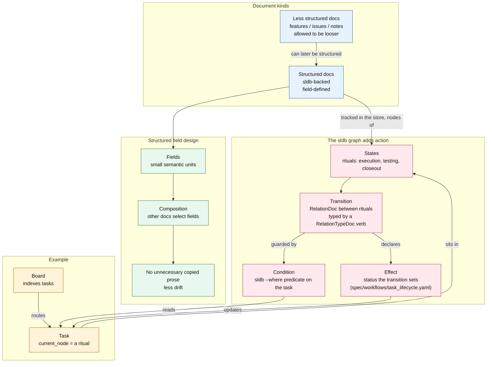

# Document Structure and the Lifecycle Graph

This diagram document is a human-facing materialization of these atoms:

- `desk/atoms/workflow-model/atom-docs-are-human-facing-atom-materializations.md`
- `desk/atoms/workflow-model/atom-rendered-diagrams-are-projections.md`
- `desk/atoms/workflow-model/atom-spec2viz-mirrors-sldb-for-diagrams.md`

The desk has both structured and less structured documents.

Structured documents are backed by `sldb`. Less structured documents can exist where precision is not yet useful, such as future features, loose issues, or notes in drawers.

## Rules

- If something is already written, reference it instead of copying it.
- Copying already-written content creates drift.
- Structured docs should expose model fields that are small enough to query and edit safely through SLDB.
- A document composed from another structured document should use SLDB composition/query surfaces rather than duplicate prose or create separate field-instance docs.
- Less structured docs are acceptable for future/deferred/unclear work, but can later be converted into structured docs when the workflow needs precision.
- The sldb graph is what gives action to `sldb` data: rituals are states, RelationDocs are transitions, and their `--where` conditions are the gates.
- A board indexes tasks; each task sits in one ritual of the lifecycle graph and moves when a transition's condition holds.
