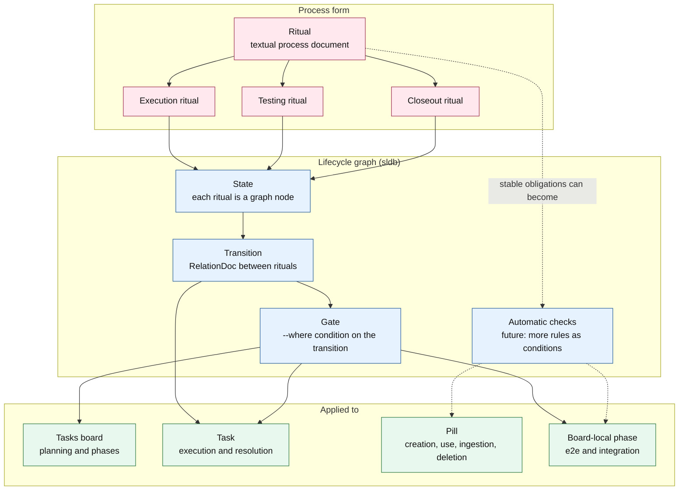

# Rituals and the Lifecycle Graph

This diagram document is a human-facing materialization of these atoms:

- `desk/atoms/workflow-model/atom-docs-are-human-facing-atom-materializations.md`
- `desk/atoms/workflow-model/atom-rendered-diagrams-are-projections.md`
- `desk/atoms/workflow-model/atom-spec2viz-mirrors-sldb-for-diagrams.md`

Rituals are the current textual form of operating process. They should be decomposed once the workflow is clear.

## Rules

- Rituals currently explain how to operate tasks, pills, code, testing, and closeout.
- Rituals have drifted and should not be treated as final architecture.
- The task lifecycle already uses the rituals as states of the desk's sldb graph; transitions between them are RelationDocs.
- Gates make preconditions explicit before progress: each transition carries an sldb `--where` condition on the task.
- As ritual obligations stabilize, more of them can become transition conditions, distinguishing automatic deterministic checks from LLM/subagent work.
- Automatic checks can run tests, validate board cleanup, block deletion, and commit when they pass; today the closeout transition plus the closeout commit do this for tasks.
- LLM/subagent tasks handle ambiguity, implementation, and semantic decisions.
